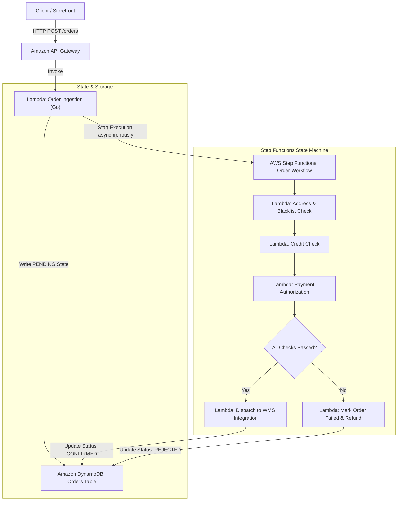

# E-Commerce Order Orchestration Pet Project
This pet project is to demonstrate the skills of AI-assisted technical design and implementation using:
- AWS - Step Functions, API Gateway, Lambda, DynamoDB, serverless architecture
- Go (Golang)
- Terraform
- Git/GitHub

# Technical Design Document: Serverless E-Commerce Order Orchestration Engine

## 1. Overview & Objectives

### 1.1 Context
Modern e-commerce platforms require fault-tolerant, asynchronous, and highly scalable order processing pipelines. When an order is placed, it must traverse several verification gates, such as address validation/blacklist screening, credit check evaluation, and payment authorization, before being dispatched to a Warehouse Management System (WMS).

### 1.2 Purpose
This technical design document outlines the architecture, data models, state workflows, and infrastructure requirements for a serverless **Order Orchestration Engine** built on AWS using Go (Golang), AWS Lambda, API Gateway, AWS Step Functions, DynamoDB, and Terraform.

---

## 2. Architecture & System Flow

The system follows an event-driven, serverless paradigm. The ingestion layer accepts client requests via HTTP API Gateway, records the initial pending state in DynamoDB, and triggers an AWS Step Functions Standard Workflow to coordinate decoupled verification microservices written in Go.



---

## 3. Component Specifications

### 3.1 API Gateway & Ingestion Lambda
* **Protocol**: HTTP API (REST API alternative for advanced throttling/authorisation if needed).
* **Handler (`cmd/api`)**: Written in Go using native routing or lightweight middleware.
* **Responsibilities**:
  1. Validate incoming JSON payload structure (using struct tags and validation libraries).
  2. Generate a unique `OrderId` (UUID v4) and timestamp.
  3. Enforce **Idempotency** using conditional DynamoDB writes (`attribute_not_exists(OrderId)`).
  4. Write initial order state (`PENDING`) to DynamoDB.
  5. Asynchronously trigger the Step Functions State Machine via AWS SDK for Go v2 (`SFN.StartExecution`).
  6. Return `202 Accepted` with the `OrderId` and execution ARN.

### 3.2 Step Functions Workflow (Amazon States Language - ASL)
* **Type**: Standard Workflow (to maintain state history, audit trails, and execution logs).
* **Error Handling Strategy**:
  * Exponential backoff and retry rules for transient downstream dependencies (e.g., payment gateways or third-party address APIs).
  * Explicit `Catch` blocks routing to compensation states if a check fails mid-workflow.

### 3.3 Verification Microservices (Go Lambdas)
Each check runs as an isolated Lambda function (`cmd/verifications/...`):
1. **Address & Blacklist Check**: Compares customer address components against internal fraud blocklists and geographic delivery zone availability.
2. **Credit Check**: Evaluates customer credit score / risk limits.
3. **Payment Authorization**: Simulates interaction with an external payment gateway (token charging/securing funds).

### 3.4 Storage Architecture (Amazon DynamoDB)
* **Table Name**: `Orders`
* **Partition Key**: `PK` (String: `ORDER#<OrderId>`)
* **Sort Key**: `SK` (String: `METADATA#<OrderId>`)
* **Global Secondary Indexes (GSI)**:
  * `CustomerIndex`: PK = `CUSTOMER#<CustomerId>`, SK = `CREATED_AT` (Enables querying order history by customer).
* **Attributes**:
  * `OrderId` (String)
  * `CustomerId` (String)
  * `OrderStatus` (`PENDING`, `VERIFIED`, `PAYMENT_FAILED`, `CONFIRMED`, `CANCELLED`)
  * `TotalAmount` (Number)
  * `Items` (List/Map)
  * `CreatedAt` / `UpdatedAt` (ISO-8601 Timestamps)

---

## 4. Infrastructure as Code (Terraform Layout)

The infrastructure is fully defined via modular Terraform code located in the `/terraform` directory:
* `main.tf`: Provider constraints, AWS region configuration, and backend state definitions.
* `dynamodb.tf`: Defines the `Orders` table with on-demand billing (`PAY_PER_REQUEST`).
* `lambda.tf`: Packages and provisions Go binary artifacts compiled for Linux (`GOOS=linux GOARCH=amd64`), managing IAM execution roles with least-privilege permissions.
* `step_functions.tf`: Deploys the ASL definition and grants Step Functions permission to invoke target Lambda functions.
* `api_gateway.tf`: Configures API Gateway routes, integration mappings, and IAM execution roles.

---

## 5. Non-Functional Requirements & Production Considerations

* **Idempotency**: Prevent duplicate order processing by leveraging DynamoDB conditional expressions during ingestion and tracking state transitions explicitly inside Step Functions.
* **Observability**: Implement structured JSON logging using Go's standard `log/slog` package. Propagate correlation IDs (`X-Correlation-Id`) from API Gateway across Step Functions execution inputs down into each individual Lambda handler.
* **Security**: Enforce IAM least-privilege access across all Lambda execution roles, utilize API Gateway request validation schemas, and store mock secrets securely via environment configuration or AWS Systems Manager Parameter Store.

# Development

## File structure
```text
ecommerce-order-aws-go/
├── .github/workflows/          # CI/CD pipeline (GitHub Actions for Terraform & Go tests)
├── cmd/                        # Entry points for individual Lambdas
│   ├── api/                    # Order Ingestion API
│   ├── verifications/          # Address, Credit, and Payment checking logic
│   └── wms-integration/        # WMS notification handler
├── internal/                   # Shared Go packages
│   ├── models/                 # Domain structs (Order, Customer, Payment)
│   ├── storage/                # DynamoDB client wrapper
│   └── middleware/             # Logging, tracing, error handling
├── terraform/                  # Infrastructure as Code
│   ├── variables.tf            # Environment variables
│   ├── main.tf                 # Provider & backend setup
│   ├── api_gateway.tf          # API Gateway HTTP/REST API setup
│   ├── lambda.tf               # Lambda definitions & IAM roles
│   ├── step_functions.tf       # ASL (Amazon States Language) definition
│   └── dynamodb.tf             # DynamoDB table schema
├── statemachine/
│   └── order_workflow.asl.json # Step Functions definition file
├── Makefile                    # Build, test, and deployment automation
└── README.md                   # Comprehensive architecture & setup guide
```

## Infrastructure as Code

### AWS Commands
```bash
aws login
aws sts get-caller-identity
aws configure
aws dynamodb list-tables
aws dynamodb describe-table --table-name ecommerce-order-orders-dev --region ap-southeast-2
aws apigatewayv2 get-apis --region ap-southeast-2
aws apigatewayv2 get-routes --api-id <YOUR_API_ID> --region ap-southeast-2
aws apigatewayv2 get-integrations --api-id <YOUR_API_ID> --region ap-southeast-2
aws apigatewayv2 get-stages --api-id <YOUR_API_ID> --region ap-southeast-2
aws lambda list-functions --region ap-southeast-2
aws lambda get-function --function-name ecommerce-order-ingest-dev --region ap-southeast-2
aws logs tail /aws/lambda/ecommerce-order-ingest-dev --follow --region ap-southeast-2
```

### Terraform Commands
```bash
cd terraform

# NEW AWS EXPERIENCE: Load credentials from cache before running terraform
source ./setup-aws-credentials.sh

# Initialize any providers or modules (good habit)
terraform init

# DEV environment — plan and apply
terraform plan -var-file="terraform-dev.tfvars"
# Apply changes interactively (you'll be prompted with a summary, type 'yes' to confirm)
terraform apply -var-file="terraform-dev.tfvars"
# Or, apply without confirmation (useful for CI/CD)
# terraform apply -var-file="terraform-dev.tfvars" -auto-approve

# PROD environment — plan and apply
terraform plan -var-file="terraform-prod.tfvars"
terraform apply -var-file="terraform-prod.tfvars"

# Destroy resources (cleanup)
terraform destroy -var-file="terraform-dev.tfvars"
```

## Go (Golang) development

For comprehensive step-by-step guidance on building and packaging Go Lambda functions, **load the Golang Build skill**:
```
.agents/skills/golang-build/SKILL.md
```

### Quick Start: Build & Package Lambda Functions

```bash
# 1. Initialize Go module (first time only)
go mod init ecommerce-order-aws-go

# 2. Install dependencies
go get github.com/aws/aws-lambda-go/events
go get github.com/aws/aws-lambda-go/lambda

# 3. Build individual Lambda handler
cd cmd/api
GOOS=linux GOARCH=amd64 CGO_ENABLED=0 go build -o bootstrap main.go
zip function.zip bootstrap
cd ../../

# 4. Or build all handlers using Makefile (recommended)
make build
```

### Build Commands

| Command | Purpose |
|---------|---------|
| `go mod download` | Fetch all dependencies |
| `go mod tidy` | Ensure consistency in go.mod / go.sum |
| `go test ./...` | Run all unit tests |
| `go fmt ./...` | Format code |
| `make build` | Build all Lambda functions |
| `make clean` | Remove build artifacts |

### CI/CD: Automated Build via GitHub Actions

The project includes an automated build workflow (`.github/workflows/build-golang.yml`) that runs on every push/PR to:
1. **Format & Lint** Go code
2. **Run Unit Tests** with coverage reporting
3. **Build** all Lambda function binaries for Linux/AMD64
4. **Package** binaries as ZIP files for Lambda deployment
5. **Security Scan** dependencies for vulnerabilities

The workflow triggers automatically on changes to:
- `cmd/**` — Lambda handler code
- `internal/**` — Shared packages
- `go.mod`, `go.sum` — Dependencies
- `Makefile` — Build automation
- `.github/workflows/build-golang.yml` — Workflow definition itself

# Testing

## Test API with curl
```bash
# Replace <api_endpoint> with your actual API Gateway URL outputted by Terraform
curl -X POST https://<api_endpoint>/orders
```
